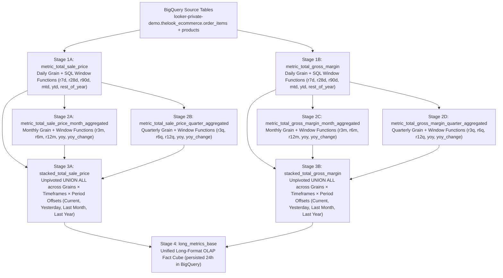
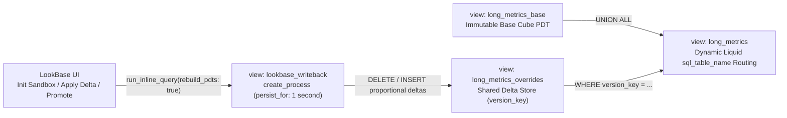

# LookBase — Multidimensional OLAP Grid & Writeback Extension for Looker

**LookBase** wraps Looker's [`viz-report-table`](./viz-report-table) submodule (without modifying a single file inside the submodule) to deliver an interactive multidimensional OLAP grid, arbitrary-depth `(member_id, parent_id)` outline hierarchies, two-pass calculations, left-hand metric autocomplete, deterministic URL query-parameter state, and zero-copy **BigQuery `CLONE` writeback sandboxes** natively on Looker + BigQuery.

---

## 1. When to Use Standard **Report Table** vs. **`LookBase`**

| Dimension | Standard **Report Table** (`viz-report-table`) | **`LookBase`** (Multidimensional OLAP Grid App) |
| :--- | :--- | :--- |
| **Target Persona** | **BI Analysts & Dashboard Consumers** viewing formatted financial statements or operational tables on a Looker dashboard. | **FP&A, Finance, & Merchandising Planners** who work in interactive ad-hoc multidimensional grids. |
| **Hierarchy Structure** | **Fixed-Column / Flat Grouping:** You pick 2–3 known dimensions (`Department`, `Category`, `Brand`), and Looker fetches all rows at once and groups them client-side. | **Unbalanced / Ragged `(member_id, parent_id)` Trees (4–20+ levels):** Hierarchies have variable depth (`WITH RECURSIVE` CTE) and unary rollups (`+`, `-`, `~`). |
| **How Drill / Expand Works** | **Client-Side Collapse of Pre-Fetched Rows:** Every leaf row must fit inside a single Looker query (typically $\le 5,000$ rows) for subtotals to be accurate. | **On-Demand SQL Branch Expansion (`Zoom In`):** Clicking `[+]` or double-clicking a parent fires `WHERE parent_id = '<member_id>'` (and saves expanded branches to batch-load together), so it never hits Looker's 5,000-row limit. |
| **Metrics & Calculations** | **Columns Defined in Explore:** Measures and Table Calculations are fixed by the dashboard author. Client-side subtotals just `SUM`/`AVG` leaf rows (which breaks ratios like `Gross Margin %` on subtotals). | **Left-Hand Metric Autocomplete & Two-Pass Formulas:** Users type to search/swap 50+ metrics down Column A (`MEMBER()`, `PARENTVAL()`, `VAR()`, `VARPER()`, `=GETVALUE(...)`), and ratios (`GM %`, `% of Parent`) recalculate **after** SQL aggregation at every parent level. |
| **Slicing & Filtering** | Standard Looker Dashboard filter bar. | **Point of View (POV) Toolbar & Deterministic URL Query Params:** Instant cube slicing by Scenario Version (`Base Cube`, `My Sandbox`, `Forecast v1`), Stacked Timeframe (`YTD`, `Rolling 7D/28D/90D/12M`), Grain, and Year—all bookmarkable via `?version=...&expanded=...`. |
| **Writeback & What-If** | **Read-Only.** | **Interactive Cell Writeback & BigQuery `CLONE` Sandboxes:** Users click a cell, type `+10%` or a new target in the Formula Bar, write back proportional deltas to their personal BigQuery `CLONE` sandbox, and trigger on-demand PDT cube rebuilds (`Calc All`). |

---

## 2. How `viz-report-table` and `LookBase` Work Together Architecturally

LookBase **does not replace** `viz-report-table`—it wraps `<ReportTable />` as its core grid rendering engine:

1. **[`viz-report-table`](./viz-report-table/src/ReportTable.tsx) (Unmodified Git Submodule — The Rendering Engine):**
   - Renders sticky headers, tree indentation, `[+]` / `[-]` collapse icons, merged pivot columns (`Current` vs. `Last Year`), and financial number formatting via [`VisPluginTableModel`](./viz-report-table/src/vis_plugin_table_model.js).
2. **[`src/essbaseEngine.ts`](./src/essbaseEngine.ts) + [`src/LookBaseExtension.tsx`](./src/LookBaseExtension.tsx) (The Multidimensional OLAP Layer Around It):**
   - Queries the `(member_id, parent_id)` recursive hierarchy in Looker (`fetchOutlineChildren`, `restoreSavedOutlineExpansion`).
   - Projects parent-child SQL rows into the synthetic `Subtotal|...` tree structure that `<ReportTable />` expects (`projectOutlineRowsToReportTable`) so parent subtotals come from **exact BigQuery SQL rollups** rather than naive client-side leaf sums.
   - Wraps `<ReportTable />` with the **POV Slice Bar**, **Formula Bar (`=GETVALUE`)**, **Left-Hand Metric Autocomplete**, **Two-Pass Calculation Evaluator**, **BigQuery `CLONE` Sandbox Writeback**, **Stacked Bottom-Right Stateful Toasts**, and **`driver.js` Guided Tours**.

---

## 3. Deterministic URL Query Parameter Reference & Quick-Start Actions

Every interactive slice, hierarchy expansion, left-hand metric dock, modal, and tour state is reloadable via URL query parameters with strict precedence:
**`1. URL Query Parameters (?...)` > `2. User Artifact (user_<id>_lookbase_prefs)` > `3. Project Config (lookbase.config.json)`**

See **[`QUICK_START_ACTIONS.md`](./QUICK_START_ACTIONS.md)** for full details on configurable, individually dismissible, and user-creatable Quick-Start Action pills.

| Query Parameter | Example | Description |
| :--- | :--- | :--- |
| `version` | `?version=sandbox` | Active Scenario Version (`base`, `sandbox`, `fcst_v1`, `fcst_v2`, `budget_final`). |
| `timeframe` | `?timeframe=qtd` | Stacked Timeframe slice (`ytd`, `qtd`, `mtd`, `r7d`, `r28d`, `r90d`, `r12m`). |
| `source` | `?source=Monthly+Agg` | Source grain (`Daily Actual`, `Monthly Agg`, `Quarterly Agg`). |
| `year` | `?year=2024` | Year filter (`ALL`, `2025`, `2024`, `2023`). |
| `member` | `?member=CAT:Men\|Jeans` | Selected outline member ID for the Formula Bar, Writeback target, and Left-Hand Metrics Dock. |
| `expanded` | `?expanded=ROOT,ALL,DEPT:Men,CAT:Men\|Jeans` | Comma-separated parent `member_id`s whose children are fetched in parallel batches and expanded in the outline tree. |
| `metrics` | `?metrics=long_metrics.total_sale_price,calc:gm_pct` | Comma-separated metric/calculation IDs pinned in the Left-Hand Metrics Dock. |
| `pane` | `?pane=1` or `?pane=0` | Show (`1`) or hide (`0`) the Left-Hand Metrics Dock. |
| `quickstart` | `?quickstart=1`, `0`, or `reset` | Show (`1`), hide (`0`), or restore (`reset`) all dismissed Quick-Start Action pills. |
| `modal` | `?modal=hierarchy` | Open the Recursive CTE Hierarchy Selector Modal on load. |
| `q` | `?q=margin` | Pre-fill the Left-Hand Metric Autocomplete search input. |
| `edit` | `?edit=%2B10%25` | Pre-fill the Formula Bar delta input (e.g., `+10%` or `350000`). |
| `tour` | `?tour=1`, `0`, `reset`, or `<guide_uuid>` | Force-launch (`1`), suppress (`0`), or reset (`reset`) the `driver.js` guided tour. |

---

## 4. LookML Explore Field Auto-Discovery (`lookbase.config.json`)

Instead of manually listing every measure, dimension, and hierarchy field in [`lookbase.config.json`](./lookbase.config.json), LookBase calls `core40SDK.lookml_model_explore("lookbase", "long_metrics", "id,name,fields")` and uses `field_discovery`:

- **`mode: "all_except_excluded"` (Default):** Automatically discovers and includes all non-hidden measures and dimensions on the `long_metrics` Explore **except** those carrying `tags: ["lookbase:exclude"]` in LookML.
- **`mode: "include_tagged"` (Opt-in):** Only includes measures and dimensions carrying `tags: ["lookbase:include"]` in LookML.
- **Parent-Child Hierarchy Tags:** Automatically binds `dim_product_hierarchy` columns tagged with `lookbase:member_id`, `lookbase:parent_id`, `lookbase:member_label`, `lookbase:member_path`, `lookbase:level_num`, and `lookbase:is_leaf`.

> **Why does `tmp/lookbase/calculations.strings.json` exist?**
> Looker's LookML validator strictly rejects plain `.json` filenames inside a LookML project unless they end in `.strings.json`. Running `npm run build` automatically copies [`lookbase.config.json`](./lookbase.config.json) into `tmp/lookbase/calculations.strings.json`.

---

## 5. What Does **Rebuild Cube** Do? (End-to-End Architecture)

Clicking **Rebuild Cube** in the top-right ribbon triggers an on-demand, full-DAG Persistent Derived Table (PDT) materialization in BigQuery through Looker's query engine, followed by a live reload of all expanded hierarchy branches in the grid.

### 5.1 Step-by-Step Execution Lifecycle

1. **UI Trigger & Persistent Toast ([`handleRebuildCube`](./src/LookBaseExtension.tsx)):**
   - Resolves the target PDT view (`viewToRebuild || calcConfig.base_pdt_view || "long_metrics_base"`).
   - Sets `isBusy = true` and pushes a persistent (`timeoutMs: null`) bottom-right `info` toast:
     `Rebuilding PDT 'long_metrics_base' (rebuild_pdts=true)...`
2. **Looker SDK Inline Query with `rebuild_pdts: true` ([`rebuildCubePdt`](./src/essbaseEngine.ts)):**
   - Calls `core40SDK.run_inline_query` against the hidden [`long_metrics_base`](./tmp/lookbase/long_metrics.view.lkml) explore:
     ```ts
     core40SDK.run_inline_query({
       result_format: "json",
       rebuild_pdts: true, // Instructs Looker's regenerator/query engine to drop & recreate the PDT and its upstream dependencies
       cache: false,       // Bypasses Looker query cache
       body: {
         model: "lookbase",
         view: "long_metrics_base",
         fields: ["long_metrics_base.count"],
         limit: "1",
       },
     });
     ```
   - **No Iframe PostMessage Timeout (`chattyTimeout: -1`):** Because rebuilding a multi-stage BigQuery PDT cascade can take 30–90+ seconds, LookBase initializes the Looker Extension Host with `connectExtensionHost({ chattyTimeout: -1 })` so `@looker/chatty` never aborts the in-flight SDK call.
3. **Outline Re-Query & Two-Pass Recalculation:**
   - As soon as BigQuery finishes materializing the PDTs, the toast transitions in-place to `success` (`Cube 'long_metrics_base' rebuilt.`), and `loadStandaloneOutline()` re-fetches all currently expanded `(member_id, parent_id)` branches from BigQuery with `cache: false` and re-evaluates all Two-Pass Calculations (`GM %`, `% of Parent Sales`, `YoY Var $`, `YoY Var %`, and Left-Hand Metrics Dock rows).

### 5.2 The 4-Stage BigQuery PDT Dependency Graph (DAG)

When `rebuild_pdts: true` targets `long_metrics_base`, Looker's PDT builder walks and materializes a **4-stage BigQuery dependency graph** defined across [`metric_total_sale_price.view.lkml`](./tmp/lookbase/metric_total_sale_price.view.lkml), [`metric_total_gross_margin.view.lkml`](./tmp/lookbase/metric_total_gross_margin.view.lkml), and [`long_metrics.view.lkml`](./tmp/lookbase/long_metrics.view.lkml):



| Stage | PDT View(s) | What BigQuery Computes During Rebuild |
| :--- | :--- | :--- |
| **Stage 1: Daily Base & Rolling Windows** | `metric_total_sale_price`, `metric_total_gross_margin` | Runs a native `explore_source: order_items` query joining `order_items` and `products` at `(product_id, department, dt, month, quarter, year)` grain. Computes partition window functions over `product_id ORDER BY dt`: `r7d` (6 preceding), `r28d` (27 preceding), `r90d` (89 preceding), `mtd` (month-to-date), `ytd` (year-to-date), and `rest_of_year` (1 following to unbounded following), tagging `source = "Daily Actual"`. |
| **Stage 2: Monthly & Quarterly Aggregations** | `metric_*_month_aggregated`, `metric_*_quarter_aggregated` | Uses `explore_source` chained onto the Stage 1 daily PDTs to roll up values to `(product_id, month, quarter, year)` and `(product_id, quarter, year)`. Computes `r3m`, `r6m`, `r12m`, `yoy` (`value - LAG(value, 12)`), and `yoy_change` for `source = "Monthly Actual"`, plus `r3q`, `r6q`, `r12q`, `yoy` (`value - LAG(value, 4)`), and `yoy_change` for `source = "Quarterly Actual"`. |
| **Stage 3: Modular Stacked Timeframe & Period-Offset Unpivot** | `stacked_total_sale_price`, `stacked_total_gross_margin` | Executes a `UNION ALL` stacking every timeframe (`current_view`, `ytd`, `ytd_row_count`, `rest_of_year`, `r7d`, `r28d`, `r90d`, `r3m`, `r6m`, `r12m`, `r3q`, `r6q`, `r12q`, `yoy`, `yoy_change`) and every time-comparison offset (`Current`, `Yesterday` via `LAG(..., 1) OVER (PARTITION BY product_id ORDER BY dt)`, `Last Month` via `LAG(..., 1) OVER (... ORDER BY month)`, and `Last Year` via `LAG(..., 365)` / `LAG(..., 12)`) into a normalized schema. |
| **Stage 4: Unified Base Cube PDT** | `long_metrics_base` | `UNION ALL`s all modular `stacked_*` measure tables into a single tall, narrow OLAP fact table (`source, product_id, department, row_count, dt, month, quarter, year, value, timeframe, metric, current_period`) persisted for 24 hours. |

### 5.3 Full Cube Rebuild vs. Modular Single-Measure Rebuild

Because each measure is isolated in its own Stage 1–3 PDT chain (`stacked_total_sale_price`, `stacked_total_gross_margin`), `rebuildCubePdt` supports two modes:
- **Full Cube Rebuild (`handleRebuildCube()`):** Targets `long_metrics_base` to re-materialize all measures and grains.
- **Modular Measure Rebuild (`handleRebuildCube("stacked_total_sale_price")`):** Rebuilds only a single measure's stacked PDT branch when only that metric's definition or underlying source changed, avoiding recomputing unrelated metrics.

### 5.4 How `Rebuild Cube` Interacts with Personal Sandboxes & Scenario Versions

LookBase stores user writeback deltas in a separate delta-store table (`long_metrics_overrides`, keyed by `version_key = 'sandbox_<user_id>'`, `'fcst_v1'`, `'fcst_v2'`, or `'budget_final'`). When `long_metrics` is queried in `sandbox` or forecast mode, Looker dynamically `UNION ALL`s `long_metrics_base` with the matching `version_key` rows from `long_metrics_overrides`:
- Rebuilding `long_metrics_base` refreshes the underlying actuals (`Base Cube`) from source data **without wiping out** a user's personal sandbox adjustments or promoted forecast deltas in `long_metrics_overrides`.
- Clicking **Init Sandbox** (`action_type = 'init_sandbox'`) resets only the current user's `version_key = 'sandbox_<user_id>'` delta slice.

---

## 6. What Is Cloning / Sandboxing, How Is It Handled in LookML, and How Can a User "Save" a Sandbox?

### 6.1 What Is Cloning / Sandboxing in LookBase?

In multidimensional FP&A and merchandising workflows, planners need to test "what-if" adjustments (e.g., increasing `Men -> Jeans` YTD sales by `+10%` or setting a new dollar target on a brand) without mutating the production `Base Cube` seen by other users, and without duplicating millions of fact rows in BigQuery every time a user opens a sandbox.

LookBase implements **Zero-Copy Virtual Cloning + Proportional Delta Writeback**:
- Instead of copying the entire `long_metrics_base` table per user, every user gets an isolated virtual clone keyed by their Looker user ID (`version_key = 'sandbox_{{ _user_attributes['id'] }}'`).
- At query time, a user's sandbox is the lossless superposition (`UNION ALL` + SQL `SUM(value)`) of the immutable **Base Cube (`long_metrics_base`)** plus their personal **Delta Override rows (`long_metrics_overrides`)**.
- Because `long_metrics` measures use `type: sum` (`SUM(value)`), positive or negative delta rows in `long_metrics_overrides` automatically roll up to every ancestor (`Brand` $\rightarrow$ `Category` $\rightarrow$ `Department` $\rightarrow$ `All Products`) in a single BigQuery pass.

> **Why a Shared `long_metrics_overrides` Table Instead of `${long_metrics_base.SQL_TABLE_NAME}_sandbox_${uid}`?**
> In Looker on BigQuery, `${view.SQL_TABLE_NAME}` resolves to a **backtick-enclosed** table identifier (e.g. `` `project.scratch.LR$..._long_metrics_base` ``). Appending a suffix like `${long_metrics_base.SQL_TABLE_NAME}_sandbox_42` produces invalid BigQuery syntax (`` `project.scratch.LR$...`_sandbox_42 ``) where the suffix lands outside the closing backtick. Using a dedicated Looker-managed PDT (`long_metrics_overrides`) partitioned logically by `version_key` avoids invalid identifier concatenation while remaining 100% native to Looker's scratch schema.

---

### 6.2 How Cloning & Writeback Are Handled in LookML ([`tmp/lookbase/long_metrics.view.lkml`](./tmp/lookbase/long_metrics.view.lkml))

The LookML architecture consists of **three cooperating views** in [`long_metrics.view.lkml`](./tmp/lookbase/long_metrics.view.lkml):



#### 1. The Delta Store PDT (`view: long_metrics_overrides`)
Created with the exact same columns as `long_metrics_base` plus a leading `version_key` (`STRING`) column:
```lookml
view: long_metrics_overrides {
  derived_table: {
    persist_for: "24 hours"
    sql:
      SELECT
        CAST(NULL AS STRING) AS version_key,
        source, product_id, department, row_count, dt, month, quarter, year, value, timeframe, metric, current_period
      FROM ${long_metrics_base.SQL_TABLE_NAME}
      WHERE 1 = 0
    ;;
  }
}
```

#### 2. Dynamic Version Routing (`view: long_metrics`)
The main `long_metrics` cube inspects `` (`base`, `sandbox`, `fcst_v1`, `fcst_v2`, `budget_final`) and routes `sql_table_name` dynamically:
```lookml
  sql_table_name:
    
      (
        SELECT source, product_id, department, row_count, dt, month, quarter, year, value, timeframe, metric, current_period
        FROM ${long_metrics_base.SQL_TABLE_NAME}
        UNION ALL
        SELECT source, product_id, department, row_count, dt, month, quarter, year, value, timeframe, metric, current_period
        FROM ${long_metrics_overrides.SQL_TABLE_NAME}
        WHERE version_key = 'sandbox_{{ _user_attributes['id'] }}'
      )
    
      (
        SELECT source, product_id, department, row_count, dt, month, quarter, year, value, timeframe, metric, current_period
        FROM ${long_metrics_base.SQL_TABLE_NAME}
        UNION ALL
        SELECT source, product_id, department, row_count, dt, month, quarter, year, value, timeframe, metric, current_period
        FROM ${long_metrics_overrides.SQL_TABLE_NAME}
        WHERE version_key = ''
      )
    
      ${long_metrics_base.SQL_TABLE_NAME}
     ;;
```

#### 3. Zero-Backend DML Execution Engine (`view: lookbase_writeback`)
Looker does not expose a generic arbitrary-SQL endpoint to extensions, so LookBase uses a hidden `create_process` PDT (`view: lookbase_writeback` with `persist_for: "1 second"`) invoked via `core40SDK.run_inline_query({ rebuild_pdts: true, cache: false })` ([`executeEssbaseWriteback`](./src/essbaseEngine.ts)):
- **`action_type = 'init_sandbox'` (Initialize / Reset Personal Clone):**
  Deletes any prior delta rows for `version_key = 'sandbox_{{ _user_attributes['id'] }}'` from `long_metrics_overrides`. Because `long_metrics` in `sandbox` mode unions `long_metrics_base` with `sandbox_<uid>`, clearing old deltas immediately gives the user a fresh, zero-copy virtual clone of `long_metrics_base`.
- **`action_type = 'write_delta'` (Top-Down or Leaf Proportional Writeback):**
  When a user selects any cell (whether a leaf brand like `BRAND:Men|Jeans|Levi's` or an aggregate parent like `CAT:Men|Jeans` or `DEPT:Men`) and enters `+10%` or a new target value in the Formula Bar, `handleSubmitCellDelta` computes `delta = targetValue - currentValue` and runs `write_delta`. The `sql_step` distributes `p_delta_value` across every leaf `product_id` belonging to `p_member_id` (via `dim_product_hierarchy`) proportional to each row's existing weight:
  ```sql
  CAST( AS FLOAT64) * COALESCE(
    SAFE_DIVIDE(m.value, NULLIF(SUM(m.value) OVER (), 0)),
    1.0 / COUNT(*) OVER ()
  ) AS value
  ```

---

### 6.3 How Can a User "Save" a Clone / Sandbox?

Users can save, persist, and share their sandbox work at **three levels**:

| Save Mechanism | How the User Triggers It | What Happens Under the Hood |
| :--- | :--- | :--- |
| **1. Automatic Persistence in Personal Sandbox (`My Sandbox`)** | Click **Init Sandbox** once, then click **Apply Delta** in the Formula Bar after editing any cell. | Every `write_delta` action writes durable rows into `long_metrics_overrides` in BigQuery under `version_key = 'sandbox_<user_id>'`. Switching POV tabs, refreshing the browser, or navigating to `?version=sandbox` preserves all personal sandbox edits automatically. |
| **2. Promote / Save Sandbox to a Shared Scenario Version (`Promote -> Fcst v1`)** | Click **`Promote -> Fcst v1`** in the Formula Bar (`handlePromoteSandbox` in [`LookBaseExtension.tsx`](./src/LookBaseExtension.tsx)). | Calls `lookbase_writeback` with `action_type = 'compact_and_promote'` and `target_version = 'fcst_v1'`. BigQuery compacts (`SUM(value) ... GROUP BY ...`) all incremental deltas from `version_key = 'sandbox_<user_id>'` and inserts them into `version_key = 'fcst_v1'` (and switches the POV dropdown to `Forecast v1`). Any teammate selecting `Forecast v1` (`?version=fcst_v1`) sees the saved forecast scenario. |
| **3. Clone a Saved Scenario Version to Another Version (`clone_version`)** | Call `executeLookBaseWriteback` with `action_type: "clone_version"`, `source_version: "fcst_v1"`, `target_version: "fcst_v2"` (or `budget_final`). | Copies all compacted delta rows from `source_version` into `target_version` inside `long_metrics_overrides` (`INSERT INTO ... SELECT '${target_version}' AS version_key ... WHERE version_key = '${source_version}'`), creating a snapshot branch for iterative planning rounds. |
| **4. Save a Named Quick-Start Bookmark (`+ Save Current View`)** | Click **`+ Save Current View`** in the Quick-Start bar above the grid (or copy the browser URL). | Persists the active `version` (`sandbox`, `fcst_v1`, etc.), `timeframe`, `source`, `year`, `member`, and `expanded` hierarchy nodes as a one-click pill inside the user's Looker Artifact (`user_<id>_lookbase_prefs`) and encodes them in the URL query string (`?version=sandbox&timeframe=ytd&expanded=...`). |

---

### 6.4 How Can a User Load a Previous Sandbox and Share It (Without URL Parameters)?

Because sandbox deltas are stored as durable rows in BigQuery (`long_metrics_overrides`) and user preferences are stored in Looker's Artifacts key-value store (`user_<id>_lookbase_prefs`), **users never need URL parameters** to reload a previous sandbox or share their scenario with colleagues:

#### A. Loading a Previous Personal Sandbox (No URL Needed)
1. **Automatic Restoration on Launch (`user_<id>_lookbase_prefs`):**
   Whenever a user changes any POV dropdown (including switching `Version` to `My Sandbox`), `handlePovChange` saves `pov` into their personal Looker Artifact (`user_<id>_lookbase_prefs`). The next time the user opens LookBase from the Looker **Applications** menu (with a clean URL), LookBase reads `user_<id>_lookbase_prefs` and automatically restores their last active `Version` (`My Sandbox`), `Timeframe`, `Source`, and `Year`.
2. **Selecting `My Sandbox` in the Top-Right `POV -> Version` Dropdown:**
   If the user switched back to `Actuals (Base)` and wants to return to their previous sandbox later (even days later or on another device), they simply open the **`POV -> Version`** dropdown in the top ribbon and select **`My Sandbox`**. Looker runs `WHERE version_key = 'sandbox_{{ _user_attributes['id'] }}'` against `long_metrics_overrides` and immediately loads all of their previously saved delta rows—as long as they do not click `Clone Base to Sandbox` (which resets `sandbox_<uid>`).
3. **One-Click Saved View Pills (`+ Save Current View`):**
   Clicking **`+ Save Current View`** in the Quick-Start bar saves a named button pill in the user's `user_<id>_lookbase_prefs` artifact. Clicking that pill at any time restores `My Sandbox` (or `Forecast v1`) along with the exact hierarchy drill-down state.

#### B. Sharing a Sandbox With Other Users (No URL Needed)
Because `sandbox_{{ _user_attributes['id'] }}` is strictly isolated per Looker user ID via `_user_attributes['id']`, another user opening `?version=sandbox` would see *their own* personal sandbox, not yours. To share your sandbox scenario with teammates:
1. **Promote Your Sandbox to a Shared Scenario Version (`Promote Sandbox → Fcst v1`):**
   While viewing **`My Sandbox`**, click **`Promote Sandbox → Fcst v1`** in the top ribbon. This triggers `action_type = 'compact_and_promote'`, which compacts all of your `sandbox_<user_id>` deltas and writes them into the shared `version_key = 'fcst_v1'` partition inside `long_metrics_overrides`.
2. **Teammates Select `Forecast v1` from the `POV -> Version` Dropdown:**
   Once promoted, any colleague can open LookBase and select **`Forecast v1`** from the top-right **`POV -> Version`** dropdown (or click the built-in **`Forecast v1 Variance`** Quick-Start pill) to inspect and analyze the exact promoted scenario—without needing a shared link or URL parameter.

---

## 7. Configuration Settings, Access Control & BigQuery BI Engine Pinning (`⚙ Settings`)

Following the access-control architecture from `lkrdev/explore-blending` (`SettingsContext.tsx` / `Settings/index.tsx`), LookBase includes an in-app **Configuration Settings (`⚙ Settings`)** modal ([`LookBaseExtension.tsx`](./src/LookBaseExtension.tsx), [`essbaseEngine.ts`](./src/essbaseEngine.ts), [`lookbaseTour.ts`](./src/lookbaseTour.ts)) that governs permissions and displays all shared PDT tables pinned to BigQuery BI Engine:

1. **Settings Access Control — Who Can Edit Settings (`restrict_settings`, `settings_group_ids`, `settings_user_ids`):**
   - When `restrict_settings` is **`false`** (default), any authenticated user can open the **`⚙ Settings`** button in the top ribbon.
   - When `restrict_settings` is **`true`**, only **Looker Admins** (users with Looker role ID `"2"`) and users matching at least one selected **Looker Group** (`settings_group_ids`) or **Looker User** (`settings_user_ids`) see the **`⚙ Settings`** button and can save configuration changes.
   - **Self-Lockout Prevention:** Mirroring `explore-blending`, [`validateLookBaseSettings`](./src/essbaseEngine.ts) blocks a non-admin user from enabling `restrict_settings` if their own `user.id` and `user.group_ids` are not included in the allowlist.
2. **Rebuild Cube Access Control — Who Can Rebuild Cube (`restrict_rebuild_cube`, `rebuild_cube_group_ids`, `rebuild_cube_user_ids`):**
   - When `restrict_rebuild_cube` is **`false`** (default), any user can click **`Calc All (Rebuild Cube)`** or **`Calc Sales PDT`**.
   - When `restrict_rebuild_cube` is **`true`**, only **Looker Admins** (role ID `"2"`) and users matching `rebuild_cube_group_ids` or `rebuild_cube_user_ids` can see and trigger **`Calc All (Rebuild Cube)`** or **`Calc Sales PDT`**.
3. **BigQuery BI Engine Pinning (`ALTER BI_CAPACITY`) — Listing All Shared PDT Tables Before Pinning:**
   - Inside [`tmp/lookbase/long_metrics.view.lkml`](./tmp/lookbase/long_metrics.view.lkml), `long_metrics_base` (`persist_for: "24 hours"`) uses a `create_process` that builds the combined cube and runs `ALTER BI_CAPACITY \`<project>.region-us.default\` SET OPTIONS (preferred_tables = [...])` across all 10 shared LookBase PDT tables (`long_metrics_base`, `dim_product_hierarchy`, `stacked_total_sale_price`, `stacked_total_gross_margin`, `metric_total_sale_price*`, and `metric_total_gross_margin*`).
   - Inside **`⚙ Settings -> 3. BigQuery BI Engine Pinning`**, [`discoverBIEngineCandidateTables`](./src/essbaseEngine.ts) resolves and lists all 10 shared PDT tables (and their live `lookerdemo_scratch.LR_...` physical names) along with the exact `ALTER BI_CAPACITY` DDL statement before rebuilding/pinning.
4. **Dual Persistence (`contextData` + Looker Artifact `global_lookbase_settings`):**
   - Clicking **Save Configuration** writes the updated [`LookBaseSettingsConfig`](./src/essbaseEngine.ts) to both Looker Extension `contextData` (`extensionSDK.saveContextData` + `refreshContextData`) and the shared Looker Artifact `global_lookbase_settings` in `lookbase_prefs`.

---

## 8. Repository Agent Skills (`.agents/skills/`)

This repository includes five specialized skills under [`.agents/skills/`](./.agents/skills):

1. **[`long-metrics-table`](./.agents/skills/long-metrics-table/SKILL.md)**: Core `explore_source` window functions, `source_parameter` grain switching, and `current_period` vs. `last_year` stacked timeframe patterns.
2. **[`lookbase-lookml`](./.agents/skills/lookbase-lookml/SKILL.md)**: Recursive `WITH RECURSIVE` `(member_id, parent_id)` hierarchies (`persist_for: "24 hours"`), modular per-measure PDTs, `rebuild_pdts: true` cube rebuilds, BI Engine pinning, and per-user BigQuery `CLONE` writeback sandboxes.
3. **[`lookbase-toasts`](./.agents/skills/lookbase-toasts/SKILL.md)**: Bottom-right stacked toast notifications (`#lookbase-toast-stack`) with per-caller timeout and in-place stateful transitions (`info` waiting spinner $\rightarrow$ `success` green / `error` red).
4. **[`lookbase-guided-tours`](./.agents/skills/lookbase-guided-tours/SKILL.md)**: Architecture and UX rules for designing and adding new `driver.js` guides using the `dismissedGuideIds` UUID array queue.
5. **[`lookbase-reset-tour`](./.agents/skills/lookbase-reset-tour/SKILL.md)**: How to reset a user's tour/preferences artifact (or via `?tour=reset` / `?quickstart=reset`) using `lkr-dev-cli` and `code-mode`.

---

## 9. Build, Test & Deploy

```bash
# Run Jest unit & integration tests
npm test -- --watchAll=false

# Build extension bundle (dist/bundle.js) and sync lookbase.config.json -> tmp/lookbase/calculations.strings.json
npm run build

# Push & deploy LookML + extension bundle to Looker via lkr-dev-cli
/usr/local/google/home/bryanweber/.local/bin/lkr-dev-cli --oauth-account=dev-googledemo2 tools lookml push tmp/lookbase --project-id=lookbase --deploy
```


