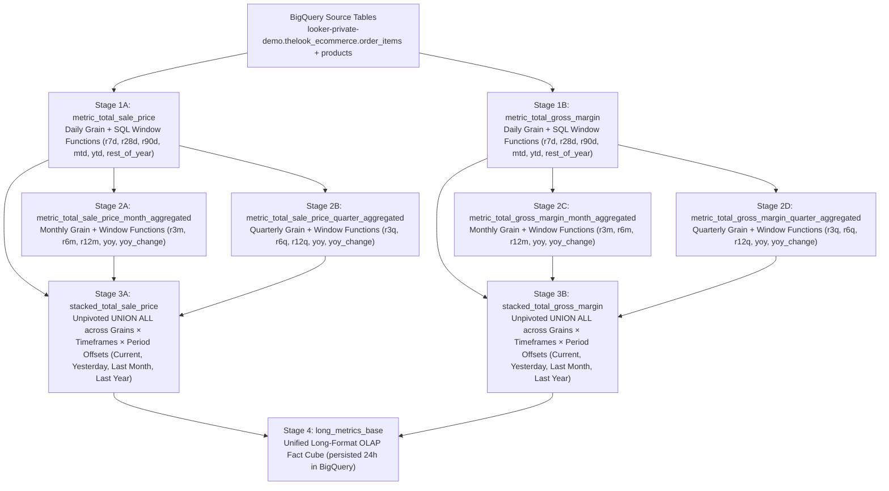
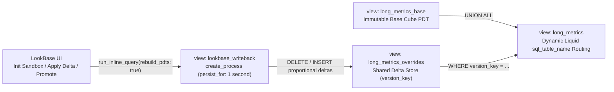

# LookBase: Multidimensional OLAP grid and writeback extension for Looker

LookBase wraps Looker's [viz-report-table](./viz-report-table) submodule without modifying any files inside the submodule. It provides an interactive multidimensional OLAP grid, arbitrary-depth `(member_id, parent_id)` outline hierarchies, two-pass calculations, left-hand metric autocomplete, deterministic URL query-parameter state, and zero-copy BigQuery `CLONE` writeback sandboxes on Looker and BigQuery.

## When to use standard Report Table vs. LookBase

| Dimension | Standard Report Table (`viz-report-table`) | LookBase (multidimensional OLAP grid app) |
| :--- | :--- | :--- |
| Target persona | BI analysts and dashboard consumers viewing formatted financial statements or operational tables on a Looker dashboard. | FP&A, finance, and merchandising planners working in interactive ad-hoc multidimensional grids. |
| Hierarchy structure | Fixed-column flat grouping. You pick 2 to 3 known dimensions (`Department`, `Category`, `Brand`), and Looker fetches all rows at once to group them client-side. | Unbalanced or ragged `(member_id, parent_id)` trees across 4 to 20+ levels. Hierarchies have variable depth (`WITH RECURSIVE` CTE) and unary rollups (`+`, `-`, `~`). |
| How drill and expand works | Client-side collapse of pre-fetched rows. Every leaf row must fit inside a single Looker query (typically 5,000 rows or fewer) for subtotals to be accurate. | On-demand SQL branch expansion (`Zoom In`). Clicking `[+]` or double-clicking a parent runs `WHERE parent_id = '<member_id>'` and saves expanded branches to batch-load together, avoiding Looker's 5,000-row limit. |
| Metrics and calculations | Columns defined in the Explore. Measures and Table Calculations are fixed by the dashboard author. Client-side subtotals sum or average leaf rows, which breaks ratios like `Gross Margin %` on subtotals. | Left-hand metric autocomplete and two-pass formulas. Users search and swap 50+ metrics down Column A (`MEMBER()`, `PARENTVAL()`, `VAR()`, `VARPER()`, `=GETVALUE(...)`), and ratios (`GM %`, `% of Parent`) recalculate after SQL aggregation at every parent level. |
| Slicing and filtering | Standard Looker dashboard filter bar. | Point of View (POV) toolbar and deterministic URL query parameters. Slice the cube by Scenario Version (`Base Cube`, `My Sandbox`, `Forecast v1`), Stacked Timeframe (`YTD`, `Rolling 7D/28D/90D/12M`), Grain, and Year, all bookmarkable via `?version=...&expanded=...`. |
| Writeback and what-if | Read-only. | Interactive cell writeback and BigQuery `CLONE` sandboxes. Users click a cell, enter `+10%` or a new target in the Formula Bar, write proportional deltas to their personal BigQuery `CLONE` sandbox, and trigger on-demand PDT cube rebuilds (`Calc All`). |

## How viz-report-table and LookBase work together

LookBase does not replace `viz-report-table`. Instead, it wraps `<ReportTable />` as its core grid rendering engine.

[viz-report-table/src/ReportTable.tsx](./viz-report-table/src/ReportTable.tsx) remains an unmodified Git submodule that renders sticky headers, tree indentation, `[+]` and `[-]` collapse icons, merged pivot columns (`Current` vs. `Last Year`), and financial number formatting through [VisPluginTableModel](./viz-report-table/src/vis_plugin_table_model.js).

Around that submodule, [src/essbaseEngine.ts](./src/essbaseEngine.ts) and [src/LookBaseExtension.tsx](./src/LookBaseExtension.tsx) provide the multidimensional OLAP layer. This layer queries the `(member_id, parent_id)` recursive hierarchy in Looker (`fetchOutlineChildren`, `restoreSavedOutlineExpansion`) and projects parent-child SQL rows into the synthetic `Subtotal|...` tree structure that `<ReportTable />` expects (`projectOutlineRowsToReportTable`). As a result, parent subtotals come from exact BigQuery SQL rollups rather than client-side leaf sums. The extension also wraps `<ReportTable />` with the POV Slice Bar, Formula Bar (`=GETVALUE`), left-hand metric autocomplete, two-pass calculation evaluator, BigQuery `CLONE` sandbox writeback, stacked bottom-right stateful toasts, and `driver.js` guided tours.

## Deterministic URL query parameter reference and quick-start actions

Every interactive slice, hierarchy expansion, left-hand metric dock, modal, and tour state can be reloaded from URL query parameters. On page load, state resolves in this order:
`1. URL query parameters (?...)` > `2. User artifact (user_<id>_lookbase_prefs)` > `3. Project config (lookbase.config.json)`

See [QUICK_START_ACTIONS.md](./QUICK_START_ACTIONS.md) for details on configurable, individually dismissible, and user-creatable quick-start action pills.

| Query parameter | Example | Description |
| :--- | :--- | :--- |
| `version` | `?version=sandbox` | Active Scenario Version (`base`, `sandbox`, `fcst_v1`, `fcst_v2`, `budget_final`). |
| `timeframe` | `?timeframe=qtd` | Stacked Timeframe slice (`ytd`, `qtd`, `mtd`, `r7d`, `r28d`, `r90d`, `r12m`). |
| `source` | `?source=Monthly+Agg` | Source grain (`Daily Actual`, `Monthly Agg`, `Quarterly Agg`). |
| `year` | `?year=2024` | Year filter (`ALL`, `2025`, `2024`, `2023`). |
| `member` | `?member=CAT:Men\|Jeans` | Selected outline member ID for the Formula Bar, Writeback target, and Left-Hand Metrics Dock. |
| `expanded` | `?expanded=ROOT,ALL,DEPT:Men,CAT:Men\|Jeans` | Comma-separated parent `member_id`s whose children are fetched in parallel batches and expanded in the outline tree. |
| `metrics` | `?metrics=long_metrics.total_sale_price,calc:gm_pct` | Comma-separated metric or calculation IDs pinned in the Left-Hand Metrics Dock. |
| `pane` | `?pane=1` or `?pane=0` | Show (`1`) or hide (`0`) the Left-Hand Metrics Dock. |
| `quickstart` | `?quickstart=1`, `0`, or `reset` | Show (`1`), hide (`0`), or restore (`reset`) all dismissed Quick-Start Action pills. |
| `modal` | `?modal=hierarchy` | Open the Recursive CTE Hierarchy Selector Modal on load. |
| `q` | `?q=margin` | Pre-fill the Left-Hand Metric Autocomplete search input. |
| `edit` | `?edit=%2B10%25` | Pre-fill the Formula Bar delta input (for example, `+10%` or `350000`). |
| `tour` | `?tour=1`, `0`, `reset`, or `<guide_uuid>` | Force-launch (`1`), suppress (`0`), or reset (`reset`) the `driver.js` guided tour. |

## LookML Explore field auto-discovery

Instead of manually listing every measure, dimension, and hierarchy field in [lookbase.config.json](./lookbase.config.json), LookBase calls `core40SDK.lookml_model_explore("lookbase", "long_metrics", "id,name,fields")` and uses `field_discovery` rules:

- The default `mode: "all_except_excluded"` discovers and includes all non-hidden measures and dimensions on the `long_metrics` Explore except those carrying `tags: ["lookbase:exclude"]` in LookML.
- The opt-in `mode: "include_tagged"` only includes measures and dimensions carrying `tags: ["lookbase:include"]` in LookML.
- Parent-child hierarchy columns in `dim_product_hierarchy` bind automatically when tagged with `lookbase:hierarchy_id`, `lookbase:member_id`, `lookbase:parent_id`, `lookbase:member_label`, `lookbase:member_path`, `lookbase:level_num`, and `lookbase:is_leaf`.

### Hierarchy discovery (`hierarchy_discovery`: `"lookml"` vs `"json"`)

LookBase supports two mutually exclusive hierarchy discovery modes in [lookbase.config.json](./lookbase.config.json) (and `calculations.strings.json`):

| Mode | Configuration | Behavior |
| :--- | :--- | :--- |
| **100% LookML (`"lookml"`, `"explore"`, or `"query"`)** | `"hierarchy_discovery": { "source": "lookml" }` (or `"hierarchy_source": "lookml"`) | Pulls **100% of hierarchies from LookML** and ignores any `hierarchies` array in the `.json` file. Queries `level_num IN (0, 1)` on the parent-child outline hierarchy (`dim_product_hierarchy.hierarchy_id`) to discover each hierarchy's root label and top-level L1 branches, and also includes any multi-level `group_label` dimension hierarchies defined on the Explore. |
| **100% JSON (`"json"`)** | `"hierarchy_discovery": { "source": "json" }` (or `"hierarchy_source": "json"`) | Pulls **100% of hierarchies from the `hierarchies` array in `.json`** and skips all LookML hierarchy queries and Explore `group_label` discovery. |

Example `hierarchy_discovery` block in `lookbase.config.json` / `calculations.strings.json`:

```json
{
  "hierarchy_discovery": {
    "source": "lookml",
    "hierarchy_id_field": "dim_product_hierarchy.hierarchy_id",
    "outline_explore": "long_metrics"
  }
}
```

If `hierarchy_discovery` (and `hierarchy_source`) is omitted, LookBase defaults to `"json"` when `hierarchies` is non-empty in the `.json` file, and `"lookml"` when `hierarchies` is omitted or empty.

Looker's LookML validator rejects plain `.json` filenames inside a LookML project unless they end in `.strings.json`. Running `npm run build` copies [lookbase.config.json](./lookbase.config.json) into `tmp/lookbase/calculations.strings.json` so the project passes LookML validation.

## How Rebuild Cube works

Clicking `Rebuild Cube` in the top-right ribbon triggers an on-demand Persistent Derived Table (PDT) materialization across the full dependency graph in BigQuery through Looker's query engine, then reloads all expanded hierarchy branches in the grid.

### Execution lifecycle

1. [handleRebuildCube](./src/LookBaseExtension.tsx) resolves the target PDT view (`viewToRebuild || calcConfig.base_pdt_view || "long_metrics_base"`), sets `isBusy = true`, and pushes a persistent (`timeoutMs: null`) bottom-right `info` toast reading `Rebuilding PDT 'long_metrics_base' (rebuild_pdts=true)...`.
2. [rebuildCubePdt](./src/essbaseEngine.ts) calls `core40SDK.run_inline_query` against the hidden [long_metrics_base](./tmp/lookbase/long_metrics.view.lkml) explore:
   ```ts
   core40SDK.run_inline_query({
     result_format: "json",
     rebuild_pdts: true, // Instructs Looker's regenerator/query engine to drop & recreate the PDT and its upstream dependencies
     cache: false,       // Bypasses Looker query cache
     body: {
       model: "lookbase",
       view: "long_metrics_base",
       fields: ["long_metrics_base.count"],
       limit: "1",
     },
   });
   ```
   Because rebuilding a multi-stage BigQuery PDT cascade can take 30 to 90+ seconds, LookBase initializes the Looker Extension Host with `connectExtensionHost({ chattyTimeout: -1 })` so `@looker/chatty` does not abort the in-flight SDK call.
3. Once BigQuery finishes materializing the PDTs, the toast transitions in-place to `success` (`Cube 'long_metrics_base' rebuilt.`). `loadStandaloneOutline()` then re-fetches all currently expanded `(member_id, parent_id)` branches from BigQuery with `cache: false` and re-evaluates all two-pass calculations (`GM %`, `% of Parent Sales`, `YoY Var $`, `YoY Var %`, and Left-Hand Metrics Dock rows).

### The 4-stage BigQuery PDT dependency graph

When `rebuild_pdts: true` targets `long_metrics_base`, Looker's PDT builder walks and materializes a 4-stage BigQuery dependency graph defined across [metric_total_sale_price.view.lkml](./tmp/lookbase/metric_total_sale_price.view.lkml), [metric_total_gross_margin.view.lkml](./tmp/lookbase/metric_total_gross_margin.view.lkml), and [long_metrics.view.lkml](./tmp/lookbase/long_metrics.view.lkml):



| Stage | PDT views | What BigQuery computes during rebuild |
| :--- | :--- | :--- |
| Stage 1: Daily base and rolling windows | `metric_total_sale_price`, `metric_total_gross_margin` | Runs a native `explore_source: order_items` query joining `order_items` and `products` at `(product_id, department, dt, month, quarter, year)` grain. Computes partition window functions over `product_id ORDER BY dt`: `r7d` (6 preceding), `r28d` (27 preceding), `r90d` (89 preceding), `mtd` (month-to-date), `ytd` (year-to-date), and `rest_of_year` (1 following to unbounded following), tagging `source = "Daily Actual"`. |
| Stage 2: Monthly and quarterly aggregations | `metric_*_month_aggregated`, `metric_*_quarter_aggregated` | Uses `explore_source` chained onto the Stage 1 daily PDTs to roll up values to `(product_id, month, quarter, year)` and `(product_id, quarter, year)`. Computes `r3m`, `r6m`, `r12m`, `yoy` (`value - LAG(value, 12)`), and `yoy_change` for `source = "Monthly Actual"`, plus `r3q`, `r6q`, `r12q`, `yoy` (`value - LAG(value, 4)`), and `yoy_change` for `source = "Quarterly Actual"`. |
| Stage 3: Modular stacked timeframe and period-offset unpivot | `stacked_total_sale_price`, `stacked_total_gross_margin` | Executes a `UNION ALL` stacking every timeframe (`current_view`, `ytd`, `ytd_row_count`, `rest_of_year`, `r7d`, `r28d`, `r90d`, `r3m`, `r6m`, `r12m`, `r3q`, `r6q`, `r12q`, `yoy`, `yoy_change`) and every time-comparison offset (`Current`, `Yesterday` via `LAG(..., 1) OVER (PARTITION BY product_id ORDER BY dt)`, `Last Month` via `LAG(..., 1) OVER (... ORDER BY month)`, and `Last Year` via `LAG(..., 365)` / `LAG(..., 12)`) into a normalized schema. |
| Stage 4: Unified base cube PDT | `long_metrics_base` | Combines all modular `stacked_*` measure tables via `UNION ALL` into a single tall, narrow OLAP fact table (`source, product_id, department, row_count, dt, month, quarter, year, value, timeframe, metric, current_period`) persisted for 24 hours. |

### Full cube rebuild vs. modular single-measure rebuild

Because each measure is isolated in its own Stage 1-3 PDT chain (`stacked_total_sale_price`, `stacked_total_gross_margin`), `rebuildCubePdt` supports two modes:
- Calling `handleRebuildCube()` runs a full cube rebuild targeting `long_metrics_base` to re-materialize all measures and grains.
- Calling `handleRebuildCube("stacked_total_sale_price")` rebuilds only a single measure's stacked PDT branch when only that metric's definition or underlying source changed, avoiding recomputing unrelated metrics.

### How Rebuild Cube interacts with personal sandboxes and scenario versions

LookBase stores user writeback deltas in a separate delta-store table (`long_metrics_overrides`, keyed by `version_key = 'sandbox_<user_id>'`, `'fcst_v1'`, `'fcst_v2'`, or `'budget_final'`). When `long_metrics` is queried in `sandbox` or forecast mode, Looker dynamically combines `long_metrics_base` and the matching `version_key` rows from `long_metrics_overrides` with `UNION ALL`:
- Rebuilding `long_metrics_base` refreshes the underlying actuals (`Base Cube`) from source data without wiping out a user's personal sandbox adjustments or promoted forecast deltas in `long_metrics_overrides`.
- Clicking `Init Sandbox` (`action_type = 'init_sandbox'`) resets only the current user's `version_key = 'sandbox_<user_id>'` delta slice.

## Cloning, sandboxing, and saving scenario versions

### How virtual cloning and sandboxing work in LookBase

In multidimensional FP&A and merchandising workflows, planners test what-if adjustments (such as increasing `Men -> Jeans` YTD sales by `+10%` or setting a new dollar target on a brand) without mutating the production `Base Cube` seen by other users, and without duplicating millions of fact rows in BigQuery every time someone opens a sandbox.

LookBase implements zero-copy virtual cloning and proportional delta writeback:
- Instead of copying the entire `long_metrics_base` table per user, every user gets an isolated virtual clone keyed by their Looker user ID (`version_key = 'sandbox_{{ _user_attributes['id'] }}'`).
- At query time, a user's sandbox combines the immutable Base Cube (`long_metrics_base`) with their personal delta override rows (`long_metrics_overrides`) using `UNION ALL` and `SUM(value)`.
- Because `long_metrics` measures use `type: sum` (`SUM(value)`), positive or negative delta rows in `long_metrics_overrides` roll up to every ancestor (`Brand` -> `Category` -> `Department` -> `All Products`) in a single BigQuery pass.

In Looker on BigQuery, `${view.SQL_TABLE_NAME}` resolves to a backtick-enclosed table identifier (for example, `` `project.scratch.LR$..._long_metrics_base` ``). Appending a suffix like `${long_metrics_base.SQL_TABLE_NAME}_sandbox_42` produces invalid BigQuery syntax (`` `project.scratch.LR$...`_sandbox_42 ``) because the suffix lands outside the closing backtick. Using a dedicated Looker-managed PDT (`long_metrics_overrides`) partitioned logically by `version_key` avoids invalid identifier concatenation while staying native to Looker's scratch schema.

### LookML implementation for cloning and writeback

The LookML setup consists of three cooperating views in [tmp/lookbase/long_metrics.view.lkml](./tmp/lookbase/long_metrics.view.lkml):



#### The delta store PDT (`view: long_metrics_overrides`)
This view is created with the same columns as `long_metrics_base` plus a leading `version_key` (`STRING`) column:
```lookml
view: long_metrics_overrides {
  derived_table: {
    persist_for: "24 hours"
    sql:
      SELECT
        CAST(NULL AS STRING) AS version_key,
        source, product_id, department, row_count, dt, month, quarter, year, value, timeframe, metric, current_period
      FROM ${long_metrics_base.SQL_TABLE_NAME}
      WHERE 1 = 0
    ;;
  }
}
```

#### Dynamic version routing (`view: long_metrics`)
The main `long_metrics` cube inspects `` (`base`, `sandbox`, `fcst_v1`, `fcst_v2`, `budget_final`) and routes `sql_table_name` dynamically:
```lookml
  sql_table_name:
    
      (
        SELECT source, product_id, department, row_count, dt, month, quarter, year, value, timeframe, metric, current_period
        FROM ${long_metrics_base.SQL_TABLE_NAME}
        UNION ALL
        SELECT source, product_id, department, row_count, dt, month, quarter, year, value, timeframe, metric, current_period
        FROM ${long_metrics_overrides.SQL_TABLE_NAME}
        WHERE version_key = 'sandbox_{{ _user_attributes['id'] }}'
      )
    
      (
        SELECT source, product_id, department, row_count, dt, month, quarter, year, value, timeframe, metric, current_period
        FROM ${long_metrics_base.SQL_TABLE_NAME}
        UNION ALL
        SELECT source, product_id, department, row_count, dt, month, quarter, year, value, timeframe, metric, current_period
        FROM ${long_metrics_overrides.SQL_TABLE_NAME}
        WHERE version_key = ''
      )
    
      ${long_metrics_base.SQL_TABLE_NAME}
     ;;
```

#### Zero-backend DML execution engine (`view: lookbase_writeback`)
Looker does not expose a generic arbitrary-SQL endpoint to extensions, so LookBase uses a hidden `create_process` PDT (`view: lookbase_writeback` with `persist_for: "1 second"`) invoked via `core40SDK.run_inline_query({ rebuild_pdts: true, cache: false })` ([executeEssbaseWriteback](./src/essbaseEngine.ts)):
- Running `action_type = 'init_sandbox'` deletes any prior delta rows for `version_key = 'sandbox_{{ _user_attributes['id'] }}'` from `long_metrics_overrides`. Because `long_metrics` in `sandbox` mode unions `long_metrics_base` with `sandbox_<uid>`, clearing old deltas gives the user a clean virtual clone of `long_metrics_base`.
- Running `action_type = 'write_delta'` handles top-down or leaf proportional writeback. When a user selects any cell (whether a leaf brand like `BRAND:Men|Jeans|Levi's` or an aggregate parent like `CAT:Men|Jeans` or `DEPT:Men`) and enters `+10%` or a new target value in the Formula Bar, `handleSubmitCellDelta` computes `delta = targetValue - currentValue` and runs `write_delta`. The `sql_step` distributes `p_delta_value` across every leaf `product_id` belonging to `p_member_id` (via `dim_product_hierarchy`) proportional to each row's existing weight:
  ```sql
  CAST( AS FLOAT64) * COALESCE(
    SAFE_DIVIDE(m.value, NULLIF(SUM(m.value) OVER (), 0)),
    1.0 / COUNT(*) OVER ()
  ) AS value
  ```

### Ways to save a sandbox

Users can save, persist, and share their sandbox work across four levels:

| Save mechanism | How the user triggers it | What happens under the hood |
| :--- | :--- | :--- |
| Automatic persistence in personal sandbox (`My Sandbox`) | Click `Init Sandbox` once, then click `Apply Delta` in the Formula Bar after editing any cell. | Every `write_delta` action writes durable rows into `long_metrics_overrides` in BigQuery under `version_key = 'sandbox_<user_id>'`. Switching POV tabs, refreshing the browser, or navigating to `?version=sandbox` preserves all personal sandbox edits. |
| Promote sandbox to a shared scenario version (`Promote -> Fcst v1`) | Click `Promote -> Fcst v1` in the Formula Bar (`handlePromoteSandbox` in [LookBaseExtension.tsx](./src/LookBaseExtension.tsx)). | Calls `lookbase_writeback` with `action_type = 'compact_and_promote'` and `target_version = 'fcst_v1'`. BigQuery compacts (`SUM(value) ... GROUP BY ...`) all incremental deltas from `version_key = 'sandbox_<user_id>'`, inserts them into `version_key = 'fcst_v1'`, and switches the POV dropdown to `Forecast v1`. Any teammate selecting `Forecast v1` (`?version=fcst_v1`) sees the saved forecast scenario. |
| Clone a saved scenario version (`clone_version`) | Call `executeLookBaseWriteback` with `action_type: "clone_version"`, `source_version: "fcst_v1"`, `target_version: "fcst_v2"` (or `budget_final`). | Copies all compacted delta rows from `source_version` into `target_version` inside `long_metrics_overrides` (`INSERT INTO ... SELECT '${target_version}' AS version_key ... WHERE version_key = '${source_version}'`), creating a snapshot branch for iterative planning rounds. |
| Save a named quick-start bookmark (`+ Save Current View`) | Click `+ Save Current View` in the Quick-Start bar above the grid (or copy the browser URL). | Persists the active `version` (`sandbox`, `fcst_v1`, etc.), `timeframe`, `source`, `year`, `member`, and `expanded` hierarchy nodes as a one-click pill inside the user's Looker Artifact (`user_<id>_lookbase_prefs`) and encodes them in the URL query string (`?version=sandbox&timeframe=ytd&expanded=...`). |

### Loading and sharing sandboxes without URL parameters

Because sandbox deltas live as durable rows in BigQuery (`long_metrics_overrides`) and user preferences live in Looker's Artifacts key-value store (`user_<id>_lookbase_prefs`), users do not need URL parameters to reload a previous sandbox or share their scenario with colleagues.

#### Loading a previous personal sandbox
1. Whenever a user changes any POV dropdown (including switching `Version` to `My Sandbox`), `handlePovChange` saves `pov` into their personal Looker Artifact (`user_<id>_lookbase_prefs`). The next time the user opens LookBase from the Looker Applications menu with a clean URL, LookBase reads `user_<id>_lookbase_prefs` and restores their last active `Version` (`My Sandbox`), `Timeframe`, `Source`, and `Year`.
2. If the user switched back to `Actuals (Base)` and wants to return to their previous sandbox later, they can open the `POV -> Version` dropdown in the top ribbon and select `My Sandbox`. Looker runs `WHERE version_key = 'sandbox_{{ _user_attributes['id'] }}'` against `long_metrics_overrides` and loads all of their previously saved delta rows, provided they have not clicked `Clone Base to Sandbox` to reset `sandbox_<uid>`.
3. Clicking `+ Save Current View` in the Quick-Start bar saves a named button pill in the user's `user_<id>_lookbase_prefs` artifact. Clicking that pill restores `My Sandbox` or `Forecast v1` along with the exact hierarchy drill-down state.

#### Sharing a sandbox with other users
Because `sandbox_{{ _user_attributes['id'] }}` is isolated per Looker user ID via `_user_attributes['id']`, another user opening `?version=sandbox` sees their own personal sandbox rather than yours. To share a sandbox scenario with teammates:
1. While viewing `My Sandbox`, click `Promote Sandbox -> Fcst v1` in the top ribbon. This triggers `action_type = 'compact_and_promote'`, which compacts all of your `sandbox_<user_id>` deltas and writes them into the shared `version_key = 'fcst_v1'` partition inside `long_metrics_overrides`.
2. Once promoted, any colleague can open LookBase and select `Forecast v1` from the top-right `POV -> Version` dropdown (or click the built-in `Forecast v1 Variance` Quick-Start pill) to inspect the promoted scenario without needing a shared link.

## Configuration settings, access control, and BigQuery BI Engine pinning

Following the access-control architecture from `lkrdev/explore-blending` (`SettingsContext.tsx` / `Settings/index.tsx`), LookBase includes an in-app Configuration Settings (`Settings`) modal ([LookBaseExtension.tsx](./src/LookBaseExtension.tsx), [essbaseEngine.ts](./src/essbaseEngine.ts), [lookbaseTour.ts](./src/lookbaseTour.ts)) that governs permissions and displays all shared PDT tables pinned to BigQuery BI Engine:

1. Settings access is controlled by `restrict_settings`, `settings_group_ids`, and `settings_user_ids`. When `restrict_settings` is `false` (default), any authenticated user can open the `Settings` button in the top ribbon. When `restrict_settings` is `true`, only Looker Admins (users with Looker role ID `"2"`) and users matching at least one selected Looker Group (`settings_group_ids`) or Looker User (`settings_user_ids`) see the `Settings` button and can save configuration changes. Mirroring `explore-blending`, [validateLookBaseSettings](./src/essbaseEngine.ts) prevents self-lockout by blocking a non-admin user from enabling `restrict_settings` if their own `user.id` and `user.group_ids` are not included in the allowlist.
2. Cube rebuild access is controlled by `restrict_rebuild_cube`, `rebuild_cube_group_ids`, and `rebuild_cube_user_ids`. When `restrict_rebuild_cube` is `false` (default), any user can click `Calc All (Rebuild Cube)` or `Calc Sales PDT`. When `restrict_rebuild_cube` is `true`, only Looker Admins (role ID `"2"`) and users matching `rebuild_cube_group_ids` or `rebuild_cube_user_ids` can see and trigger `Calc All (Rebuild Cube)` or `Calc Sales PDT`.
3. Inside [tmp/lookbase/long_metrics.view.lkml](./tmp/lookbase/long_metrics.view.lkml), `long_metrics_base` (`persist_for: "24 hours"`) uses a `create_process` that builds the combined cube and runs `ALTER BI_CAPACITY \`<project>.region-us.default\` SET OPTIONS (preferred_tables = [...])` across all 10 shared LookBase PDT tables (`long_metrics_base`, `dim_product_hierarchy`, `stacked_total_sale_price`, `stacked_total_gross_margin`, `metric_total_sale_price*`, and `metric_total_gross_margin*`). Inside the BigQuery BI Engine Pinning section of the Settings modal, [discoverBIEngineCandidateTables](./src/essbaseEngine.ts) resolves and lists all 10 shared PDT tables (and their live `lookerdemo_scratch.LR_...` physical names) along with the exact `ALTER BI_CAPACITY` DDL statement before rebuilding or pinning.
4. Clicking `Save Configuration` writes the updated [LookBaseSettingsConfig](./src/essbaseEngine.ts) to both Looker Extension `contextData` (`extensionSDK.saveContextData` + `refreshContextData`) and the shared Looker Artifact `global_lookbase_settings` in `lookbase_prefs`.

## Repository agent skills

This repository includes five skills under [.agents/skills/](./.agents/skills):

1. [long-metrics-table](./.agents/skills/long-metrics-table/SKILL.md) covers core `explore_source` window functions, `source_parameter` grain switching, and `current_period` vs. `last_year` stacked timeframe patterns.
2. [lookbase-lookml](./.agents/skills/lookbase-lookml/SKILL.md) covers recursive `WITH RECURSIVE` `(member_id, parent_id)` hierarchies (`persist_for: "24 hours"`), modular per-measure PDTs, `rebuild_pdts: true` cube rebuilds, BI Engine pinning, and per-user BigQuery `CLONE` writeback sandboxes.
3. [lookbase-toasts](./.agents/skills/lookbase-toasts/SKILL.md) covers bottom-right stacked toast notifications (`#lookbase-toast-stack`) with per-caller timeouts and in-place stateful transitions (`info` waiting spinner to `success` green or `error` red).
4. [lookbase-guided-tours](./.agents/skills/lookbase-guided-tours/SKILL.md) covers architecture and UX rules for designing and adding new `driver.js` guides using the `dismissedGuideIds` UUID array queue.
5. [lookbase-reset-tour](./.agents/skills/lookbase-reset-tour/SKILL.md) shows how to reset a user's tour or preferences artifact (or via `?tour=reset` and `?quickstart=reset`) using `lkr-dev-cli` and `code-mode`.

## Build, test, and deploy

```bash
# Run Jest unit & integration tests
npm test -- --watchAll=false

# Build extension bundle (dist/bundle.js) and sync lookbase.config.json -> tmp/lookbase/calculations.strings.json
npm run build

# Push & deploy LookML + extension bundle to Looker via lkr-dev-cli
/usr/local/google/home/bryanweber/.local/bin/lkr-dev-cli --oauth-account=dev-googledemo2 tools lookml push tmp/lookbase --project-id=lookbase --deploy
```
